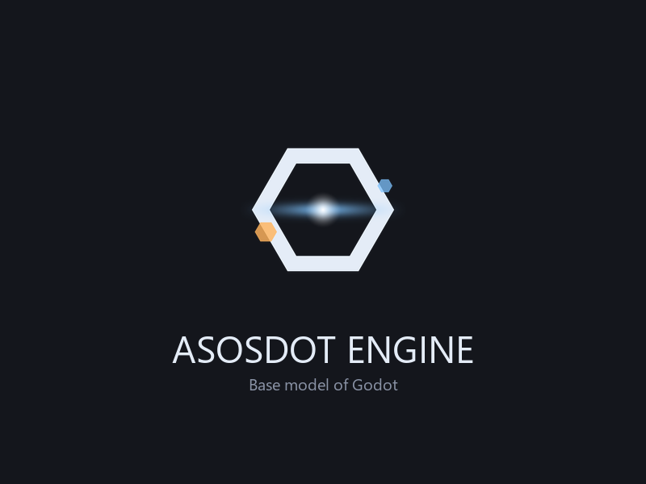

# Asosdot Engine

<p align="center">
  
</p>

**Created by Aosjes or formerly Multi-Games Studio. Base model of Godot.**

Asosdot Engine is a fork of [Godot Engine](https://godotengine.org) 4.7, built
to make the games Aosjes actually ships rather than to be a general purpose
engine. Everything Godot does, Asosdot does; the difference is what has been
added on top.

## What this fork adds

**Lens flare.** A `LensFlare3D` node, a `LensFlare` resource and a screen space
pass that draws into the HDR colour buffer before glow and tonemapping, so a
flare blooms and is exposed with the rest of the frame instead of being painted
over a finished image. Six analytic element shapes plus nine bundled textures,
per camera filtering, depth buffer occlusion, and a **Generate flare** button in
the 3D toolbar that sets a flare up from whatever light is selected.

**Ray traced lighting.** Ambient occlusion, sun shadows, one bounce global
illumination and reflections, traced against a top level acceleration structure
built from the scene's meshes, denoised and accumulated over time. Behind the
`Asos Lighting` toggle in the environment.

**Rope3D.** Verlet simulated rope that can pin either end to any `Node3D`, drawn
either as a generated tube or as a mesh instanced per segment.

## Licence

Asosdot Engine is released under the [MIT licence](LICENSE.txt), the same terms
as the Godot Engine it is built on. Godot's copyright notices are retained in
`LICENSE.txt` and `COPYRIGHT.txt`, as that licence requires, and the About
dialog lists every third-party component the engine ships.

Godot Engine is © 2014-present Godot Engine contributors and © 2007-2014 Juan
Linietsky, Ariel Manzur. "Godot" is a trademark of the Godot Foundation; this
fork is not affiliated with or endorsed by them.

The bundled lens flare textures are CC0, by hc (hackcraft.de), from
[OpenGameArt](https://opengameart.org/content/lens-flares-and-particles). See
[thirdparty/lens_flare/README.md](thirdparty/lens_flare/README.md) for the
changes made to them.

## Building

```
scons platform=windows target=editor d3d12=no
```

`d3d12=no` has to be on the command line: `platform/windows/detect.py` forces it
on and only the command line can override a platform flag. The binary lands in
`bin/` named after `short_name` in `version.py`.

For everything else, Godot's own
[build documentation](https://docs.godotengine.org/en/latest/contributing/development/compiling/)
applies unchanged.
