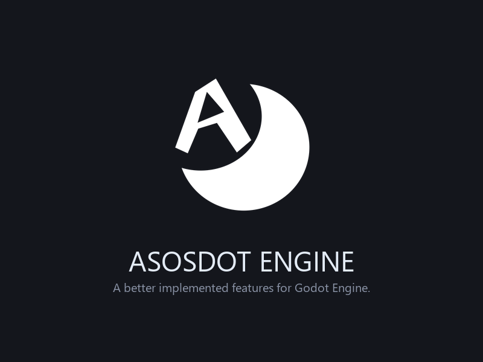

# Asosdot Engine

<p align="center">
  
</p>

**Created by Aosjes or formerly Multi-Games Studio. Base model of Godot.**

Asosdot Engine is a fork of [Godot Engine](https://godotengine.org) 4.7, built
to make the games Aosjes actually ships rather than to be a general purpose
engine. Everything Godot does, Asosdot does; the difference is what has been
added on top.

## What this fork adds

**Lens flare.** A `LensFlare3D` node, a `LensFlare` resource and a screen space
pass that draws into the HDR colour buffer before glow and tonemapping, so a
flare blooms and is exposed with the rest of the frame instead of being painted
over a finished image. Six analytic element shapes plus nine bundled textures,
per camera filtering (layers, plus `Camera3D.lens_flare_max_count` to keep only
the nearest few, and `lens_flare_ghost_limit` so the rings of many lights do not
pile up in the middle of the screen), depth buffer occlusion with per-object exceptions, and a
**Generate flare** button in the 3D toolbar that sets a flare up from whatever
light is selected.

**Ray traced lighting.** Ambient occlusion, sun shadows, one bounce global
illumination and reflections, traced against a top level acceleration structure
built from the scene's meshes, denoised and accumulated over time. Behind the
`Asos Lighting` toggle in the environment.

**Realtime global illumination.** A `RealtimeGI` node in the spirit of Unity's
Enlighten: bounced light for static scenes that follows every light as it
moves, turns, switches on and off, or changes colour, the sun and a flashlight
included. A bake cuts static surfaces into patches and traces how light travels
between them and from the sky, which depends on nothing but the geometry. Each
frame the GPU then lights the patches with the scene's lights as they are,
with traced shadows, bounces that through the baked transport, and writes a
lightmap the static meshes sample; repeated frames converge on every bounce.
Dynamic objects take the bounce from a grid of probes. Meshes imported without
UV2 get it generated during the bake, and large scenes get coarser patches on
large surfaces and a patch budget, so a 450 by 600 meter level bakes in under
20 seconds. Static lights are drawn into the lightmap entirely and cost nothing
per pixel. Forward+ and Mobile; check it with
`python misc/scripts/test_realtime_gi.py --engine <editor>`.

**Save and load.** A `SaveState` node under any node lists the properties to
keep, picked from a checklist in the inspector, and the `Saves` singleton does the
rest: slots on disk with a header a menu can read (time, play time, screenshot,
your own summary), the scene the save was made in restored on load, nodes that
come and go (enemies, pickups) brought back or removed as the save says, typed
arrays, node references and resources kept, version migration, autosave, a
backup if a save is damaged, and writes that never leave half a file. Saves are
encrypted with AES-256 and authenticated with HMAC-SHA256 under a project key and
an optional password, so a save that has been edited, or opened with the wrong
password, is refused rather than decoded to nonsense. Check it with
`python misc/scripts/test_saves.py --engine <editor>`.

**Motion blur.** Tick Motion Blur on a `CameraAttributes` (on a `WorldEnvironment`
or a `Camera3D`) and anything that moves across the screen is smeared the way a
camera's shutter smears it: a turn or a run blurs the whole view, sky included,
and every moving object blurs against a still background, from the same velocity
buffer temporal anti-aliasing uses. Streaks stay in front of or behind what they
belong to, intensity is the shutter fraction (half is a film camera's 180
degrees), the longest streak is capped as a share of the screen, and a target
frame rate keeps it looking the same at 60 and at 144 frames a second. It works
on the HDR image before glow and tonemapping, so bright things leave bright
streaks. Forward+ only; check it with
`python misc/scripts/test_motion_blur.py --engine <editor>`.

**ADScript.** Asosdot's GDScript is called ADScript in the editor and in its
messages. It is the same language with more on top, and only the name people read
changed: scripts are still `.gd` files and `GDScript` resources, so Godot projects,
addons and editor extensions for GDScript work as they are.

**Getting nodes and waiting.** Every node has `find_node("Player")`, which finds a
node by name anywhere in the scene (the one nearest the top if several share it,
then autoloads), or only inside one node with `enemy.find_node("Hitbox", true)`;
`get_node_safe("HUD/Score")`, which takes a path or a bare name
and gives `null` instead of an error; and `wait(1.5)`, which is
`await get_tree().create_timer(1.5).timeout` made short, takes a function to call
when the time is up, stops while its node is paused, and does nothing at all if
its node is freed first instead of failing with "class instance is gone". A
project's own `func wait()` and the like keep working, and win. Check them with
`python misc/scripts/test_adscript.py --engine <editor>`.

**Decals you can aim.** A `Decal` can be limited to chosen nodes: put them in
`affected_nodes` (or call `add_affected_node`) and only they are painted, with no
layers to set up, however the decal's box sits. A node stands for everything
visible in it, and a body hit by a ray stands for its mesh. `Decal.create_at()`
puts a texture on a surface in one call, shaped like the texture, limited to the
object that was hit, and fading away after a lifetime if you give one: bullet
holes and scorch marks are one line. The inspector has Fit to Texture and Limit to
Selected Nodes. Works in Forward+ and Mobile; check it with
`python misc/scripts/test_decal_filter.py --engine <editor> --rendering-method mobile`.

**LightCatcher3D.** Tells gameplay how lit something is, for stealth and horror
games where enemies should notice a player in the light or caught in a
flashlight beam. It measures a few points with the renderer's own light
formulas (energy, colour, range, attenuation, spot cones, cookies, distance
fade, physical units), checked pixel for pixel against the screen, with walls
blocking light through physics raycasts or through the meshes that cast
shadows, and signals when the player
becomes lit and when a particular light lands on them or leaves. `measure_point()`
answers the same for any spot, and in the editor its gizmo shows how lit each
point is while you place lights. Check it with
`python misc/scripts/test_light_catcher.py --engine <editor>`.

**Rope3D.** Verlet simulated rope that can pin either end to any `Node3D`, drawn
either as a generated tube or as a mesh instanced per segment.

**Animation workspace.** An **Animation** screen beside **3D**, laid out for
cutscenes and rigs: the viewer, a library of animations, shots, sounds and
poses, auto-key recording, camera cuts, a camera monitor with a multicam strip
to cut between cameras live, and a Blender-style **Graph Editor** that draws
every animated number as a curve to edit with Blender's keys. See
[editor/animation/README.animation_workspace.md](editor/animation/README.animation_workspace.md).

## Godot 4.7 compatibility

A Godot 4.7 project opens and runs in Asosdot as it does in Godot 4.7, and goes
back the same way:

- **Your class names come first.** When a project's own extension or script
  class has the name of an Asosdot class, such as the Terrain3D extension or a
  lens flare add-on's `LensFlare`, the project's class takes the name, as it
  does in Godot 4.7. Asosdot then leaves that feature out of the project,
  together with its editor tools, and says so in the Output panel. Asosdot's
  internal editor classes all start with `Asosdot`, so they can't clash at all.
- **Editor state means the same in both.** The 3D viewport's display mode and
  the selected main screen are saved with the numbers Godot 4.7 uses.
- **Imports go back cleanly.** A model Asosdot imported with its own nodes, such
  as a rig's `BlenderConstraint3D`s, is imported again by Godot 4.7 instead of
  loaded with nodes it doesn't have. A `.blend` that Godot 4.7 imported is
  imported again by Asosdot, where Blender is set up, to add what Asosdot adds.

Scenes you save with Asosdot's own nodes keep them, and Godot 4.7 keeps them
too, as placeholders it can't run. Everything Asosdot adds to Godot's own
classes is new, so nothing a Godot 4.7 project or GDExtension uses has changed.

Run the check with `python misc/scripts/test_godot_compat.py --engine
bin/asosdot.windows.editor.x86_64.exe --godot <Godot 4.7 editor>`.

## License

Asosdot's own original contributions are released under the
[MUIG Usage License](MUIG-LICENSE.txt): free for any use, including
commercial use, provided that modified versions of the engine are shared
back publicly in source form under the same license. Games and other
works made with Asosdot are unrestricted.

The Godot Engine code Asosdot is built on remains under the
[MIT license](LICENSE.txt). Godot's copyright notices are retained in
`LICENSE.txt` and `COPYRIGHT.txt`, as that license requires, and the About
dialog lists every third-party component the engine ships.

Godot Engine is © 2014-present Godot Engine contributors and © 2007-2014 Juan
Linietsky, Ariel Manzur. "Godot" is a trademark of the Godot Foundation; this
fork is not affiliated with or endorsed by them.

The bundled lens flare textures are CC0, by hc (hackcraft.de), from
[OpenGameArt](https://opengameart.org/content/lens-flares-and-particles). See
[thirdparty/lens_flare/README.md](thirdparty/lens_flare/README.md) for the
changes made to them.

## Exporting games

Games export with Asosdot's own export templates, built from the same source as
the editor. Godot's templates for the same base version would make games without
Asosdot's nodes (such as `BlenderConstraint3D` and `Rope3D`) and fixes (such as
layered audio and camera cuts), so Asosdot keeps its templates in a folder of
their own, `export_templates/asosdot.1.0.stable`. It never downloads Godot's, and
**Install from File** refuses a Godot `.tpz` with a message saying why.

Build and package the Windows templates with:

```
scons platform=windows target=template_release arch=x86_64 d3d12=yes
scons platform=windows target=template_debug arch=x86_64 d3d12=yes
python misc/scripts/make_export_templates.py
```

That makes `bin/Asosdot-Export-Templates-1.0.stable.tpz`. Install it from
**Editor > Manage Export Templates > Install from File**. The script packages
whatever templates are in `bin/`: Linux and Web templates build the same way
with `platform=linuxbsd` or `platform=web` (Web needs Emscripten).

The macOS template needs a Mac, so GitHub builds it. Push a tag to start the
`Asosdot macOS export templates` workflow:

```
git tag asosdot-macos-templates-<n>
git push origin asosdot-macos-templates-<n>
```

Its `asosdot-macos-templates` artifact holds a universal `macos.zip`; put that
in `bin/` before running the packaging script. A tag with `-debug` in its name
builds the debug template too. A Windows editor exports macOS games from it,
signed ad hoc with the built-in codesign. iOS templates still need a Mac with
Xcode.

GDExtensions a project uses, such as GodotSteam or Terrain3D, export with it as
they do with Godot's templates.

## Building

```
scons platform=windows target=editor d3d12=yes
```

On Direct3D 12, Asosdot gives the resource descriptor heap
(`rendering/rendering_device/d3d12/max_resource_descriptors`) 524288 entries
by default, where Godot gives 65536, and the editor at least 1000000. Every
render pass takes about 47, including each face of each shadowed omni light, so
a level with many shadowed lights filled Godot's heap and drew black. If it
fills anyway, the error says how full it is and which shaders hold the most.

`d3d12=yes` needs the Direct3D 12 SDK files, which
`python misc/scripts/install_d3d12_sdk_windows.py` downloads; `d3d12=no`
builds without the Direct3D 12 renderer. Either way it goes on the command
line: `platform/windows/detect.py` forces it on and only the command line can
override a platform flag. The binary lands in `bin/` named after `short_name`
in `version.py`.

For everything else, Godot's own
[build documentation](https://docs.godotengine.org/en/latest/contributing/development/compiling/)
applies unchanged.
